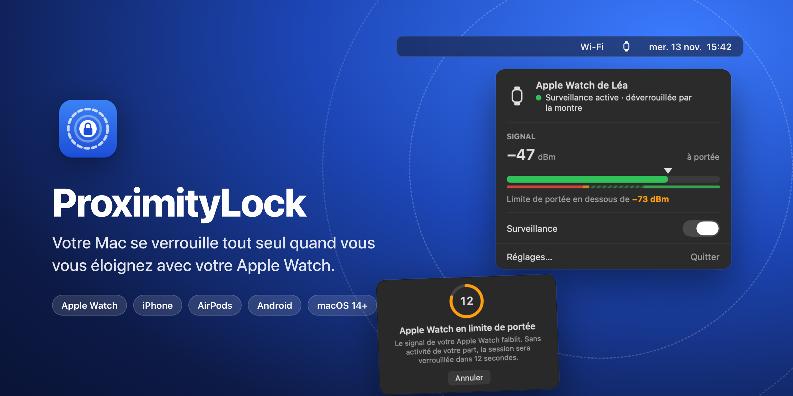
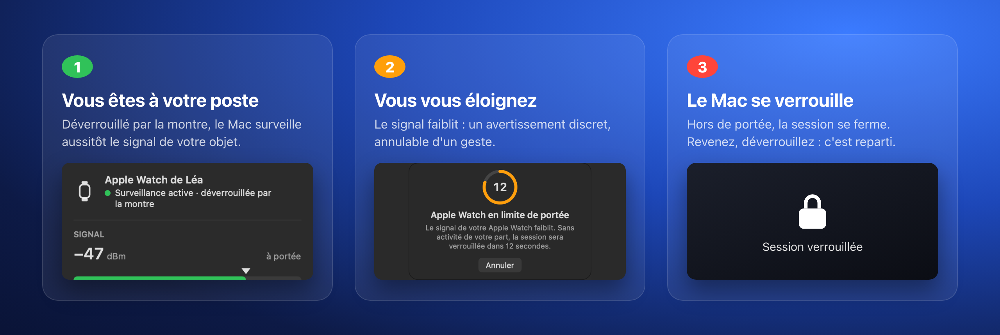
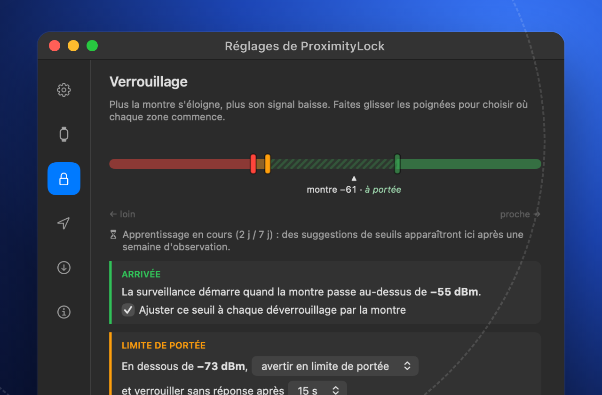
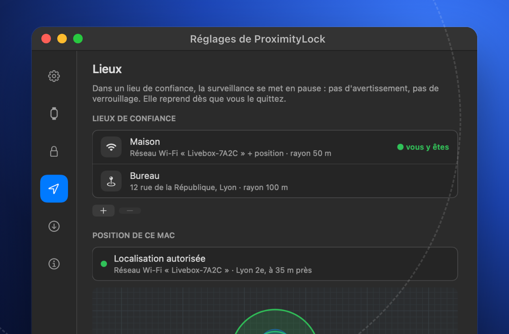
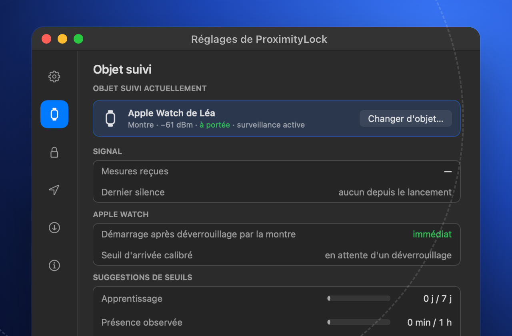
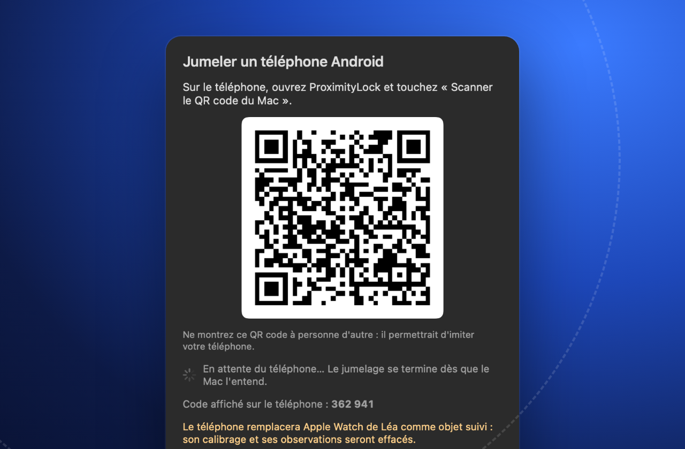

  
  &nbsp;
  

macOS 14 ou plus récent · Mac à puce Apple

## Comment ça marche

ProximityLock mesure en continu le signal Bluetooth d'un objet que vous gardez sur vous. Quand il
faiblit, vous vous êtes éloigné : un avertissement, puis la session se verrouille. Pas de compte,
pas de serveur : tout se passe sur votre Mac.

## Ce qu'il sait faire

<table>
<tr>
<td width="50%"> <b>Réglé à votre bureau</b> Trois zones — arrivée, limite de portée, verrouillage — que vous placez d'un glissement. Après une semaine, ProximityLock vous suggère les seuils qui collent à vos habitudes.</td>
<td width="50%"> <b>Lieux de confiance</b> À la maison, la surveillance se met en pause toute seule : le lieu est reconnu à votre réseau Wi-Fi, à votre adresse, ou aux deux.</td>
</tr>
<tr>
<td width="50%"> <b>Avec l'objet de votre choix</b> Apple Watch, iPhone, AirPods… n'importe quel objet Bluetooth que vous emportez avec vous. Avec l'Apple Watch, la surveillance démarre dès le déverrouillage par la montre.</td>
<td width="50%"> <b>Aussi avec un téléphone Android</b> Le compagnon Android émet un code qui change toutes les 30 secondes : impossible de l'imiter en le copiant. Le jumelage se fait en scannant un QR code.</td>
</tr>
</table>

## Installer

1. Téléchargez `ProximityLock-<version>.dmg` dans la [dernière version](https://github.com/NoktuaLabs/ProximityLock-releases/releases/latest),
   ouvrez-le et glissez **ProximityLock** dans **Applications**.
2. Au premier lancement, macOS demande une confirmation : **Réglages Système → Confidentialité et
   sécurité → Ouvrir quand même**.
3. L'assistant vous guide : autorisation Bluetooth, objet à suivre, ouverture à la session.

## Compagnon Android

Pour suivre un téléphone Android, installez le compagnon sur le téléphone : le fichier
`ProximityLock-compagnon-<version>.apk` est joint à la version macOS où il a changé (aujourd'hui la
[version 1.4](https://github.com/NoktuaLabs/ProximityLock-releases/releases/tag/v1.4)). Ouvrez cette
page depuis le téléphone, téléchargez le fichier et ouvrez-le, puis jumelez le téléphone depuis le Mac
(Réglages → Objet suivi → Changer d'objet… → Jumeler…). Android 8 ou plus récent.

## Questions fréquentes

<b>Mes données quittent-elles le Mac ?</b>

Non. Le signal mesuré, vos réglages, vos lieux et votre position restent sur le Mac. ProximityLock
ne contacte GitHub que pour chercher les mises à jour, et le service Plans d'Apple quand vous
cherchez une adresse pour un lieu de confiance.

<b>Pourquoi macOS dit-il que l'app ne vient pas de l'App Store ?</b>

ProximityLock est distribué en dehors de l'App Store et signé par NoktuaLabs, sans passer par la
notarisation d'Apple. macOS demande donc une confirmation au premier lancement, une seule fois
(Réglages Système → Confidentialité et sécurité → Ouvrir quand même).

<b>Comment se font les mises à jour ?</b>

ProximityLock vérifie les nouvelles versions (chaque jour par défaut) et vous les propose, ou les
installe seul si vous l'avez choisi. Avant d'installer, il vérifie que la nouvelle version est
signée par le même certificat que lui : une app modifiée serait refusée.

<b>Et si ma montre n'a plus de batterie ?</b>

Pour ProximityLock, un objet qui n'émet plus est un objet parti : la session se verrouille si
« Verrouiller aussi si le signal disparaît » est coché (c'est le réglage par défaut). Vous
déverrouillez ensuite comme d'habitude.

<b>ProximityLock déverrouille-t-il aussi le Mac ?</b>

Non. Il ne fait que verrouiller. Le déverrouillage reste celui de macOS : mot de passe, Touch ID ou
Apple Watch.

<b>Et si la session se verrouille alors que je suis à mon bureau ?</b>

Un avertissement de quelques secondes précède le verrouillage : un mouvement de souris l'annule. Les
seuils se règlent dans Réglages → Verrouillage, et ProximityLock vous suggère après une semaine des
seuils adaptés à votre poste.

---

Une app <a href="https://github.com/NoktuaLabs"><b>NoktuaLabs</b></a> · apps · humain × IA

